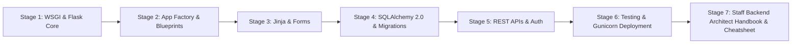
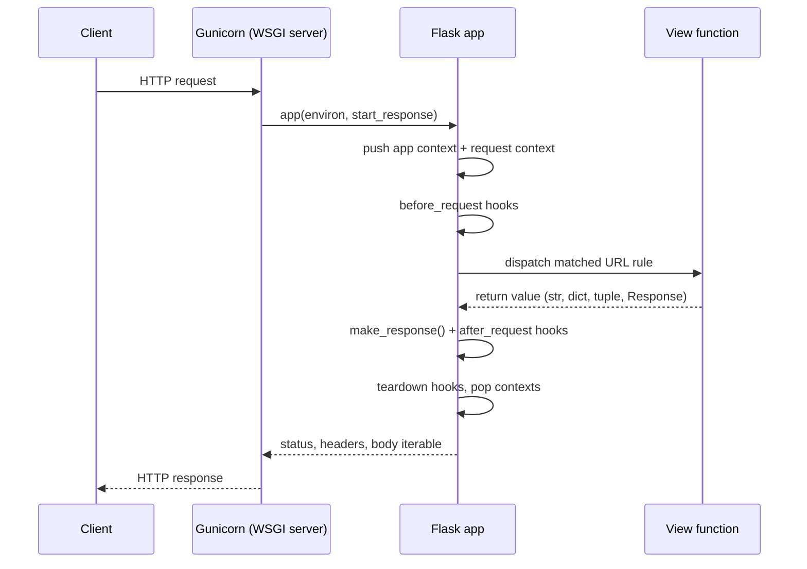
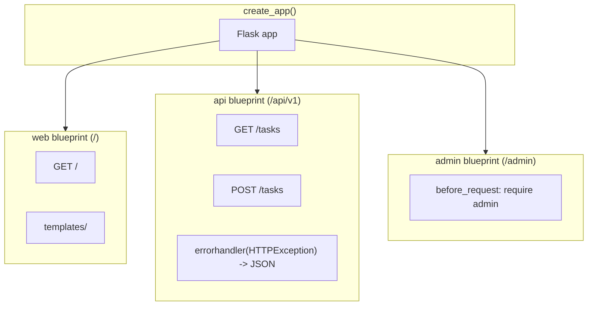
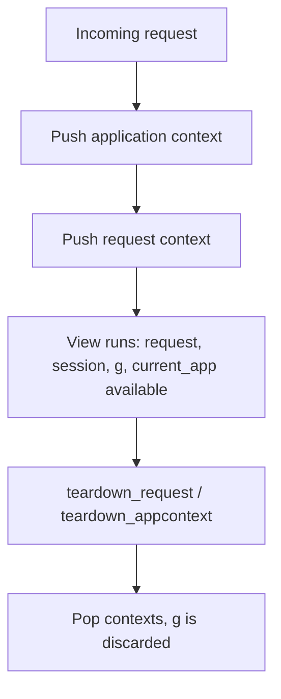
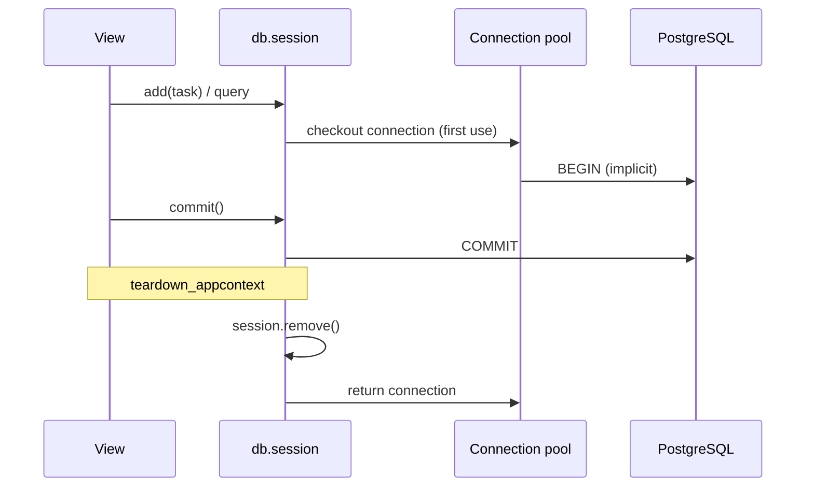
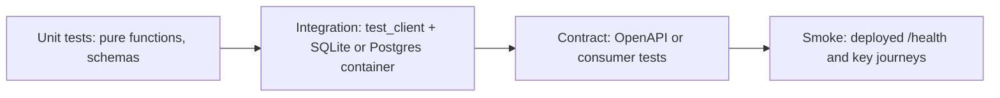
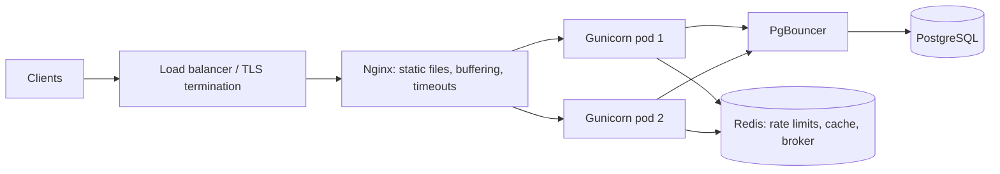

# Learn Flask 🧪

<div align="center">

[](https://opensource.org/licenses/MIT)
[](https://www.python.org/)
[](https://flask.palletsprojects.com/)
[](https://www.sqlalchemy.org/)
[](https://gunicorn.org/)
[](https://github.com/TheLearningHubOrg/learn-flask)

**An exhaustive, production-grade masterclass from absolute zero to staff-level Flask and WSGI backend architecture.**  
Master the application factory and blueprints, Jinja templating, SQLAlchemy 2.0 models and migrations, REST API design, session and token authentication, pytest-driven testing, and hardened Gunicorn deployments.

[Getting Started](#1-stage-1-absolute-beginner-foundations--wsgi-core) • [App Factory & Blueprints](#2-stage-2-application-factory-blueprints--configuration) • [Jinja Templates](#3-stage-3-jinja-templates-forms--server-rendering) • [SQLAlchemy](#4-stage-4-sqlalchemy-20-data-layer--migrations) • [APIs & Auth](#5-stage-5-rest-apis-authentication--security) • [Testing & Deployment](#6-stage-6-testing-observability--production-wsgi-deployment) • [Staff Handbook](#7-stage-7-staff-backend-architect-interview-handbook--cheatsheet)

<br/>

<a href="https://www.buymeacoffee.com/manthanank">
  
</a>

</div>

---

## 🗺️ 7-Stage Pedagogical Roadmap



| Stage | Domain Focus | Core Concepts & Production Outcomes |
| :--- | :--- | :--- |
| **Stage 1** | **Absolute Beginner Foundations & WSGI Core** | The WSGI callable contract, Werkzeug and Jinja under the hood, `@app.get`/`@app.post` routing, URL converters, the `request` object, response tuples, `flask --app ... run --debug`. |
| **Stage 2** | **Application Factory, Blueprints & Configuration** | `create_app()`, deferred `init_app()` extensions, `Blueprint` registration with `url_prefix`, layered config objects, `instance/` folder, app and request contexts, `current_app` and `g`. |
| **Stage 3** | **Jinja Templates, Forms & Server Rendering** | `` and ``, autoescaping and the `\|safe` trap, macros, custom filters, context processors, Flask-WTF forms with CSRF tokens, flash messages, signed cookie sessions. |
| **Stage 4** | **SQLAlchemy 2.0 Data Layer & Migrations** | Flask-SQLAlchemy 3.x, `Mapped[]` typed models, relationships, `db.select()` queries, `db.paginate()`, `selectinload` against N+1, request-scoped sessions, Alembic migrations through Flask-Migrate. |
| **Stage 5** | **REST APIs, Authentication & Security** | JSON blueprints, Pydantic request validation, JSON error handlers, Flask-Login sessions, scrypt password hashing, short-lived JWTs, security headers, CORS, rate limiting, `SECRET_KEY_FALLBACKS` rotation. |
| **Stage 6** | **Testing, Observability & Production WSGI Deployment** | pytest fixtures, `test_client()` and `test_cli_runner()`, custom CLI commands, async views and task queues, structured logging, Gunicorn worker models, `post_fork` engine disposal, `ProxyFix`, multi-stage Docker. |
| **Stage 7** | **Staff Backend Architect Interview Handbook** | 40 staff-level scenario Q&As covering context locals, worker sizing, connection pools, session security, migrations under load and failure triage, plus an enterprise cheatsheet. |

---

## 📋 Table of Contents
- [1. Stage 1: Absolute Beginner Foundations & WSGI Core](#1-stage-1-absolute-beginner-foundations--wsgi-core)
  - [1.1 WSGI & the Request Lifecycle](#11-wsgi--the-request-lifecycle)
  - [1.2 Installation & Your First Application](#12-installation--your-first-application)
  - [1.3 Routing, HTTP Methods & URL Converters](#13-routing-http-methods--url-converters)
  - [1.4 The Request & Response Objects](#14-the-request--response-objects)
  - [1.5 Running the Companion Project](#15-running-the-companion-project)
- [2. Stage 2: Application Factory, Blueprints & Configuration](#2-stage-2-application-factory-blueprints--configuration)
  - [2.1 Why the Application Factory Exists](#21-why-the-application-factory-exists)
  - [2.2 Building `create_app()`](#22-building-create_app)
  - [2.3 Blueprints for Modular Feature Boundaries](#23-blueprints-for-modular-feature-boundaries)
  - [2.4 Configuration Layers, Secrets & the Instance Folder](#24-configuration-layers-secrets--the-instance-folder)
  - [2.5 Application & Request Contexts](#25-application--request-contexts)
  - [2.6 Hooks, Signals & Extension Authoring](#26-hooks-signals--extension-authoring)
- [3. Stage 3: Jinja Templates, Forms & Server Rendering](#3-stage-3-jinja-templates-forms--server-rendering)
  - [3.1 Template Inheritance & Layouts](#31-template-inheritance--layouts)
  - [3.2 Autoescaping & Template Security](#32-autoescaping--template-security)
  - [3.3 Filters, Macros & Context Processors](#33-filters-macros--context-processors)
  - [3.4 Forms & CSRF with Flask-WTF](#34-forms--csrf-with-flask-wtf)
  - [3.5 Sessions, Flash Messages & Static Assets](#35-sessions-flash-messages--static-assets)
- [4. Stage 4: SQLAlchemy 2.0 Data Layer & Migrations](#4-stage-4-sqlalchemy-20-data-layer--migrations)
  - [4.1 Wiring Flask-SQLAlchemy](#41-wiring-flask-sqlalchemy)
  - [4.2 Typed Models & Relationships](#42-typed-models--relationships)
  - [4.3 Queries, Pagination & the N+1 Trap](#43-queries-pagination--the-n1-trap)
  - [4.4 Session Lifecycle & Transactions](#44-session-lifecycle--transactions)
  - [4.5 Schema Migrations with Flask-Migrate](#45-schema-migrations-with-flask-migrate)
- [5. Stage 5: REST APIs, Authentication & Security](#5-stage-5-rest-apis-authentication--security)
  - [5.1 Designing a JSON API with Blueprints](#51-designing-a-json-api-with-blueprints)
  - [5.2 Request Validation with Pydantic](#52-request-validation-with-pydantic)
  - [5.3 Centralized Error Handling](#53-centralized-error-handling)
  - [5.4 Session Authentication with Flask-Login](#54-session-authentication-with-flask-login)
  - [5.5 Stateless Token Authentication (JWT)](#55-stateless-token-authentication-jwt)
  - [5.6 Security Headers, CORS & Rate Limiting](#56-security-headers-cors--rate-limiting)
- [6. Stage 6: Testing, Observability & Production WSGI Deployment](#6-stage-6-testing-observability--production-wsgi-deployment)
  - [6.1 Testing with pytest & the Test Client](#61-testing-with-pytest--the-test-client)
  - [6.2 Custom CLI Commands](#62-custom-cli-commands)
  - [6.3 Async Views & Background Work](#63-async-views--background-work)
  - [6.4 Structured Logging & Health Checks](#64-structured-logging--health-checks)
  - [6.5 Gunicorn: Workers, Timeouts & Forking](#65-gunicorn-workers-timeouts--forking)
  - [6.6 Containers & the Reverse Proxy](#66-containers--the-reverse-proxy)
- [7. Stage 7: Staff Backend Architect Interview Handbook & Cheatsheet](#7-stage-7-staff-backend-architect-interview-handbook--cheatsheet)
  - [7.1 Enterprise Production Cheatsheet](#71-enterprise-production-cheatsheet)
  - [7.2 Staff & Principal Architect Interview Q&A (40 Scenarios)](#72-staff--principal-architect-interview-qa-40-scenarios)
- [🤝 Contributing](#-contributing)
- [📄 License](#-license)

---

## 1. Stage 1: Absolute Beginner Foundations & WSGI Core

Flask is a deliberately small web framework. The core gives you routing, a request and response model, templating and a configuration system, and leaves every other decision (database, forms, auth, API style) to you and to extensions. That minimalism is the reason Flask still powers a large share of Python backends: you can read the whole request path in an afternoon, and nothing happens that you did not wire up yourself.

### 1.1 WSGI & the Request Lifecycle

Flask is a **WSGI** application. WSGI (PEP 3333) is the synchronous contract between a Python web server and a Python web app: the server calls your app once per request with an `environ` dict and a `start_response` callback, and your app returns an iterable of bytes. Everything Flask does sits on top of that one function call.

```python
# The entire WSGI contract, with no framework at all.
def tiny_app(environ, start_response):
    path = environ.get("PATH_INFO", "/")
    body = f"You asked for {path}\n".encode()
    start_response("200 OK", [("Content-Type", "text/plain"), ("Content-Length", str(len(body)))])
    return [body]

# Flask's Flask object is just a much richer version of this callable:
#   app(environ, start_response) -> iterable of bytes
```

Flask is built on two libraries from the same Pallets project:

1. **Werkzeug** supplies the WSGI plumbing: request and response objects, URL routing maps, the development server, the debugger, and security helpers such as password hashing.
2. **Jinja** is the template engine, with sandboxing, inheritance and autoescaping.
3. **Click** powers the `flask` command-line interface, and **itsdangerous** signs the session cookie.



The key mental model: one request occupies one worker thread (or greenlet) for its full duration. Concurrency comes from the server running many workers, not from Flask itself.

### 1.2 Installation & Your First Application

```bash
# 1. Create an isolated environment (Python 3.10+)
python -m venv .venv
source .venv/bin/activate        # Windows: .venv\Scripts\activate

# 2. Install Flask (current stable 3.x)
pip install "flask>=3.1"

# 3. Run a single-file app with the reloader and debugger enabled
flask --app hello run --debug
```

```python
# hello.py
from flask import Flask

app = Flask(__name__)


@app.get("/")
def home():
    return "Hello from Flask"


@app.get("/greet/<name>")
def greet(name: str):
    # Returning a dict produces a JSON response automatically.
    return {"message": f"Hello, {name}"}
```

The first argument to `Flask(__name__)` tells Flask where the application package lives, which is how it finds the `templates/` and `static/` folders next to your code. `--debug` turns on the interactive debugger and auto-reloader; it must never be enabled on a public server, because the debugger allows arbitrary code execution from the browser.

### 1.3 Routing, HTTP Methods & URL Converters

Routes map a URL rule plus HTTP method to a view function. Since Flask 2.0 the method shortcuts (`@app.get`, `@app.post`, `@app.put`, `@app.patch`, `@app.delete`) are the clearest way to declare them.

```python
from flask import Flask, abort, redirect, url_for

app = Flask(__name__)
ARTICLES = {1: "Intro to WSGI", 2: "Blueprints in depth"}


# 1. Typed converters: int, float, path, uuid, string (default)
@app.get("/articles/<int:article_id>")
def show_article(article_id: int):
    title = ARTICLES.get(article_id)
    if title is None:
        abort(404)
    return {"id": article_id, "title": title}


# 2. The path converter accepts slashes
@app.get("/files/<path:subpath>")
def show_file(subpath: str):
    return {"requested": subpath}


# 3. Several methods on one rule with the classic decorator
@app.route("/ping", methods=["GET", "HEAD"])
def ping():
    return "pong"


# 4. Build URLs from endpoint names, never by string concatenation
@app.get("/latest")
def latest():
    return redirect(url_for("show_article", article_id=max(ARTICLES)))
```

Rules ending in a slash (`/docs/`) behave like folders: visiting `/docs` redirects to `/docs/`. Rules without a trailing slash (`/about`) return 404 for `/about/`. Picking one style and applying it consistently avoids duplicate URLs for search engines and caches.

### 1.4 The Request & Response Objects

`request` is a context-local proxy to the current Werkzeug `Request`. It looks global but always points at the request being handled by the current thread.

```python
from flask import Flask, make_response, request

app = Flask(__name__)


@app.post("/echo")
def echo():
    # 1. Query string:   /echo?verbose=1
    verbose = request.args.get("verbose", default=0, type=int)

    # 2. JSON body (returns None instead of raising when silent=True)
    data = request.get_json(silent=True) or {}

    # 3. Form fields and uploaded files
    name = request.form.get("name")
    upload = request.files.get("avatar")

    # 4. Headers and client metadata
    agent = request.headers.get("User-Agent", "unknown")

    payload = {"json": data, "name": name, "has_file": upload is not None}
    if verbose:
        payload["agent"] = agent

    # 5. Return value forms: body | (body, status) | (body, status, headers)
    return payload, 200, {"X-Echo": "1"}


@app.get("/download")
def download():
    # make_response gives full control when you need to set cookies or headers
    resp = make_response("id,title\n1,Intro\n")
    resp.mimetype = "text/csv"
    resp.headers["Content-Disposition"] = "attachment; filename=articles.csv"
    resp.set_cookie("last_download", "articles", httponly=True, samesite="Lax")
    return resp
```

Flask converts view return values as follows:

| Return value | Resulting response |
| :--- | :--- |
| `str` / `bytes` | `text/html` body with status 200 |
| `dict` / `list` | JSON via `app.json` (lists are supported since Flask 2.2) |
| `(body, status)` | Body with a custom status code |
| `(body, status, headers)` | Plus extra headers |
| `Response` object | Used as-is |
| Generator | Streamed response (wrap with `stream_with_context` if it reads `request`) |

### 1.5 Running the Companion Project

This repository contains a small, complete application that follows the patterns taught in Stages 2 to 6: an app factory, a `web` blueprint with Jinja templates, an `api` blueprint with a JSON task API, Flask-SQLAlchemy models, pytest tests and a Gunicorn Dockerfile.

```
learn-flask/
├── Dockerfile
├── pyproject.toml
├── requirements.txt
├── src/
│   ├── wsgi.py                # Gunicorn entry point
│   └── app/
│       ├── __init__.py        # create_app() factory
│       ├── config.py          # Development / Testing / Production classes
│       ├── extensions.py      # db = SQLAlchemy(...)
│       ├── models.py          # Task model
│       ├── api/               # JSON blueprint at /api/v1
│       ├── web/               # HTML blueprint at /
│       └── templates/
└── tests/
    └── test_api.py
```

```bash
# 1. Install dependencies
python -m venv .venv && source .venv/bin/activate
pip install -r requirements.txt

# 2. Create tables and start the dev server
cd src
APP_ENV=development flask --app wsgi init-db
APP_ENV=development flask --app wsgi run --debug

# 3. Exercise the API
curl -X POST localhost:5000/api/v1/tasks -H "Content-Type: application/json" -d '{"title": "Read Stage 2"}'
curl localhost:5000/api/v1/tasks

# 4. Run the test suite from the repository root
cd .. && pytest -q
```

---

## 2. Stage 2: Application Factory, Blueprints & Configuration

### 2.1 Why the Application Factory Exists

A single module with `app = Flask(__name__)` at import time works for demos and breaks down quickly in real projects:

1. **Circular imports.** Views import `app` to get the decorator, and `app` imports views to register them.
2. **Untestable configuration.** The app is configured once at import, so tests cannot build an app pointed at a throwaway database.
3. **Hidden global state.** Extensions bound to a module-level app cannot be reused by a second app in the same process.

The **application factory** fixes all three by moving construction into a function. Nothing exists until `create_app()` is called, and each call returns a new, independently configured app.

```
BEFORE (module-level app)              AFTER (factory)
-------------------------              ---------------
app.py:  app = Flask(...)              extensions.py:  db = SQLAlchemy()      # unbound
         db = SQLAlchemy(app)          app/__init__.py:
views.py: from app import app             def create_app(cfg):
          @app.route(...)                     app = Flask(__name__)
app.py:  import views   # cycle!              db.init_app(app)
                                              app.register_blueprint(api_bp)
                                              return app
```

### 2.2 Building `create_app()`

```python
# src/app/__init__.py
from __future__ import annotations

from flask import Flask

from .config import CONFIGS
from .extensions import db


def create_app(config_name: str = "development", **overrides) -> Flask:
    app = Flask(__name__, instance_relative_config=True)

    # 1. Configuration: defaults, then optional instance file, then overrides
    app.config.from_object(CONFIGS[config_name])
    app.config.from_pyfile("settings.py", silent=True)   # instance/settings.py
    app.config.from_prefixed_env()                        # FLASK_SECRET_KEY, FLASK_SQLALCHEMY_DATABASE_URI ...
    app.config.update(overrides)

    # 2. Extensions: bind the unbound instances to this app
    db.init_app(app)

    # 3. Blueprints: import inside the function to avoid import cycles
    from .api import api_bp
    from .web import web_bp

    app.register_blueprint(web_bp)
    app.register_blueprint(api_bp, url_prefix="/api/v1")

    return app
```

```python
# src/app/extensions.py
from flask_sqlalchemy import SQLAlchemy
from sqlalchemy.orm import DeclarativeBase


class Base(DeclarativeBase):
    pass


db = SQLAlchemy(model_class=Base)   # created once, attached per app with init_app()
```

The `flask` CLI and Gunicorn both understand factories directly: `flask --app "app:create_app('production')" run` and `gunicorn "app:create_app('production')"` call the function for you. A two-line `wsgi.py` that calls the factory is still worth having, because it gives operators a single, obvious import target.

### 2.3 Blueprints for Modular Feature Boundaries

A **blueprint** is a deferred bundle of routes, error handlers, templates and static files. It records everything you declare on it and replays those registrations when `app.register_blueprint()` is called. Blueprints are the unit of modularity in Flask: one per feature area or API version.



```python
# src/app/api/__init__.py
from flask import Blueprint

api_bp = Blueprint("api", __name__)

from . import routes  # noqa: E402  (importing registers the views on api_bp)
```

```python
# src/app/api/routes.py (excerpt)
from flask import url_for

from ..extensions import db
from ..models import Task
from . import api_bp


@api_bp.get("/tasks/<int:task_id>")
def get_task(task_id: int):
    return db.get_or_404(Task, task_id).to_dict()


@api_bp.post("/tasks")
def create_task():
    ...
    # Endpoint names are namespaced by blueprint: "api.get_task"
    return task.to_dict(), 201, {"Location": url_for("api.get_task", task_id=task.id)}
```

Blueprint rules worth memorizing:

1. **Endpoints are namespaced.** Inside the blueprint, `url_for(".get_task")` is a relative reference; from anywhere else use `url_for("api.get_task")`.
2. **Hooks are scoped.** `@api_bp.before_request` runs only for this blueprint's routes, while `@api_bp.before_app_request` runs for every request in the app.
3. **Error handlers are scoped too**, with one caveat: a blueprint handler cannot catch a 404 for a URL that matched no rule at all, because routing fails before any blueprint is selected. Register app-wide 404 and 405 handlers on the app.
4. **Nesting is supported** (`parent_bp.register_blueprint(child_bp)`), which suits `/api` containing `/v1` and `/v2`.
5. **The same blueprint can be registered twice** with different `url_prefix` and `name` values, for example to serve an API at both a versioned and an unversioned path during a migration.

### 2.4 Configuration Layers, Secrets & the Instance Folder

`app.config` is a dict subclass with loaders for objects, files, JSON/TOML and environment variables. A layered approach keeps secrets out of version control:

```python
# src/app/config.py
import os


class Config:
    SECRET_KEY = os.environ.get("SECRET_KEY", "dev-only-change-me")
    SQLALCHEMY_DATABASE_URI = os.environ.get("DATABASE_URL", "sqlite:///learn_flask.db")
    SQLALCHEMY_ENGINE_OPTIONS = {"pool_pre_ping": True}
    MAX_CONTENT_LENGTH = 1 * 1024 * 1024        # 413 for bodies over 1 MB


class DevelopmentConfig(Config):
    DEBUG = True


class TestingConfig(Config):
    TESTING = True                              # exceptions propagate to the test
    SQLALCHEMY_DATABASE_URI = "sqlite:///:memory:"


class ProductionConfig(Config):
    SESSION_COOKIE_SECURE = True
    SESSION_COOKIE_HTTPONLY = True
    SESSION_COOKIE_SAMESITE = "Lax"
    PREFERRED_URL_SCHEME = "https"


CONFIGS = {"development": DevelopmentConfig, "testing": TestingConfig, "production": ProductionConfig}
```

| Layer | Loader | Typical content |
| :--- | :--- | :--- |
| Code defaults | `from_object()` | Safe defaults, feature flags, per-environment classes |
| Instance file | `from_pyfile("settings.py", silent=True)` | Host-specific values in the git-ignored `instance/` folder |
| Environment | `from_prefixed_env()` | `FLASK_*` variables injected by the platform; values are parsed as JSON where possible |
| Overrides | `config.update(**overrides)` | Values passed by tests or scripts |

Production checklist for configuration:

1. **`SECRET_KEY`** must be long, random and loaded from a secret store. Generate one with `python -c "import secrets; print(secrets.token_hex(32))"`.
2. **Rotate keys without logging everyone out** using `SECRET_KEY_FALLBACKS` (added in Flask 3.1): put the new key in `SECRET_KEY` and the old one in the fallbacks list until existing sessions expire.
3. **`TRUSTED_HOSTS`** (Flask 3.1) restricts which `Host` headers are accepted, which blocks host-header poisoning of generated URLs.
4. **`MAX_CONTENT_LENGTH`**, `MAX_FORM_MEMORY_SIZE` and `MAX_FORM_PARTS` cap request body, form field and multipart sizes to blunt memory-exhaustion attacks.

### 2.5 Application & Request Contexts

Flask uses **context locals** so that views can call `request`, `session`, `current_app` and `g` without passing them around. Under the hood these are `contextvars`, so each thread (or greenlet, or asyncio task) sees its own values.



| Proxy | Lives in | Lifetime | Use it for |
| :--- | :--- | :--- | :--- |
| `current_app` | App context | Per request or `with app.app_context()` | Reading config, logger, extensions |
| `g` | App context | Same as above | Per-request cache: current user, DB connection, request ID |
| `request` | Request context | One HTTP request | Body, headers, args |
| `session` | Request context | Signed cookie across requests | Small user-scoped state |

```python
from flask import current_app, g


def get_current_tenant():
    # Cache an expensive lookup once per request on g
    if "tenant" not in g:
        g.tenant = load_tenant_from_header()
    return g.tenant


# Outside a request (scripts, shell, background jobs) push the context yourself
app = create_app("production")
with app.app_context():
    current_app.logger.info("Running maintenance with %s", current_app.config["SQLALCHEMY_DATABASE_URI"])
```

The classic error `RuntimeError: Working outside of application context` means code touched `current_app`, `g` or an extension (such as `db.session`) with no context pushed. The fix is a `with app.app_context():` block, never a module-level app import.

### 2.6 Hooks, Signals & Extension Authoring

```python
from time import perf_counter
from uuid import uuid4

from flask import Flask, g, request


def register_request_hooks(app: Flask) -> None:
    @app.before_request
    def start_timer():
        g.request_id = request.headers.get("X-Request-ID", uuid4().hex)
        g.started = perf_counter()

    @app.after_request
    def add_timing_headers(response):
        elapsed_ms = (perf_counter() - g.started) * 1000
        response.headers["X-Request-ID"] = g.request_id
        response.headers["Server-Timing"] = f"app;dur={elapsed_ms:.1f}"
        return response

    @app.teardown_request
    def log_failures(exc):
        if exc is not None:
            app.logger.error("request %s failed: %r", g.get("request_id"), exc)
```

Hook order matters: `before_request` functions run in registration order and can short-circuit by returning a response; `after_request` runs only when no unhandled exception occurred and must return the response; `teardown_*` always runs, receives the exception if there was one, and must never raise.

Writing your own extension follows the same factory-friendly shape as Flask-SQLAlchemy: an object you create once and bind with `init_app()`, storing per-app state on `app.extensions` rather than on `self`.

```python
class AuditLog:
    def __init__(self, app=None):
        if app is not None:
            self.init_app(app)

    def init_app(self, app):
        app.config.setdefault("AUDIT_ENABLED", True)
        app.extensions["audit_log"] = self

        @app.after_request
        def _record(response):
            if app.config["AUDIT_ENABLED"] and request.method != "GET":
                app.logger.info("audit %s %s -> %s", request.method, request.path, response.status_code)
            return response


audit = AuditLog()   # in extensions.py, then audit.init_app(app) inside create_app()
```

---

## 3. Stage 3: Jinja Templates, Forms & Server Rendering

Server-rendered HTML is still Flask's home turf. Jinja templates live in the `templates/` folder of the app package (or of a blueprint that sets `template_folder`) and are rendered with `render_template()`.

### 3.1 Template Inheritance & Layouts

```html
<!-- templates/base.html -->
<!doctype html>
<html lang="en">
<head>
  <meta charset="utf-8">
  <meta name="viewport" content="width=device-width, initial-scale=1">
  <title>Learn Flask</title>
  <link rel="stylesheet" href="{{ url_for('static', filename='app.css') }}">
</head>
<body>
  <nav><a href="{{ url_for('web.index') }}">Tasks</a></nav>
  
    
      <p class="flash flash-{{ category }}">{{ message }}</p>
    
  
  <main></main>
</body>
</html>
```

```html
<!-- templates/index.html -->

Tasks | {{ super() }}

  <h1>Tasks ({{ tasks | length }})</h1>
  <ul>
    
      <li class="{{ 'done' if task.done }}">{{ loop.index }}. {{ task.title }}</li>
    
      <li>No tasks yet.</li>
    
  </ul>

```

Inheritance builds pages from a single skeleton: child templates override named blocks, `{{ super() }}` keeps the parent's content, and ` ... ` handles empty collections without an extra `if`.

### 3.2 Autoescaping & Template Security

Flask enables autoescaping for `.html`, `.htm`, `.xml`, `.xhtml` and `.svg` templates. Any `{{ value }}` is HTML-escaped, so a task titled `<script>alert(1)</script>` renders as harmless text. The companion test `test_index_page_escapes_user_content` asserts exactly this.

The ways to defeat that protection are all explicit, which makes them easy to grep for in review:

1. **`{{ value | safe }}`** and **`Markup(value)`** mark a string as trusted. Use them only for HTML you generated or sanitized yourself.
2. **``** blocks disable escaping for a region.
3. **`render_template_string(user_input)`** is a server-side template injection hole: a user who controls the template source can execute code. Always pass user data as a variable, never as the template.
4. **Escaping is context-specific.** HTML escaping does not protect values placed in a `<script>` block or an `onclick` attribute; use the `tojson` filter for data passed to JavaScript.

```html
<script>
  // tojson produces a safely escaped JavaScript literal
  const initialTasks = {{ tasks_payload | tojson }};
</script>
```

### 3.3 Filters, Macros & Context Processors

```python
from datetime import datetime, timezone

from flask import Flask


def register_template_helpers(app: Flask) -> None:
    @app.template_filter("ago")
    def ago(value: datetime) -> str:
        seconds = int((datetime.now(timezone.utc) - value).total_seconds())
        if seconds < 60:
            return "just now"
        if seconds < 3600:
            return f"{seconds // 60} min ago"
        return f"{seconds // 3600} h ago"

    @app.context_processor
    def inject_globals():
        # Available in every template without passing it from each view
        return {"app_version": app.config.get("APP_VERSION", "dev")}
```

```html
{# templates/_macros.html #}

  <label for="{{ field.id }}">{{ field.label.text }}</label>
  {{ field(**kwargs) }}
  
    <span class="error">{{ error }}</span>
  


{# usage in another template #}

{{ render_field(form.title, placeholder="What needs doing?") }}
<small>Created {{ task.created_at | ago }} · v{{ app_version }}</small>
```

### 3.4 Forms & CSRF with Flask-WTF

Browsers attach cookies to cross-site form posts, so any cookie-authenticated form needs **CSRF protection**. Flask-WTF adds a signed, per-session token to each form and rejects posts without a valid one.

```python
# pip install flask-wtf
from flask import flash, redirect, render_template, url_for
from flask_wtf import FlaskForm
from flask_wtf.csrf import CSRFProtect
from wtforms import StringField, SubmitField
from wtforms.validators import DataRequired, Length

csrf = CSRFProtect()          # csrf.init_app(app) in create_app()


class TaskForm(FlaskForm):
    title = StringField("Title", validators=[DataRequired(), Length(max=200)])
    submit = SubmitField("Add task")


@web_bp.route("/tasks/new", methods=["GET", "POST"])
def new_task():
    form = TaskForm()
    if form.validate_on_submit():            # POST + valid CSRF token + validators pass
        db.session.add(Task(title=form.title.data.strip()))
        db.session.commit()
        flash("Task created.", "success")
        return redirect(url_for("web.index"))  # Post/Redirect/Get avoids double submits
    return render_template("new_task.html", form=form)
```

```html
<form method="post" novalidate>
  {{ form.hidden_tag() }}   {# renders the csrf_token hidden input #}
  {{ render_field(form.title) }}
  {{ form.submit() }}
</form>
```

JSON APIs that authenticate with a bearer token rather than a cookie are not exposed to CSRF in the same way; exempt such a blueprint with `csrf.exempt(api_bp)`, and keep CSRF on for every cookie-authenticated route.

### 3.5 Sessions, Flash Messages & Static Assets

Flask's default `session` is a **client-side signed cookie**: the data is serialized, signed with `SECRET_KEY` via itsdangerous, and sent to the browser. It is tamper-proof but **not encrypted**, so users can read its contents. Keep it small (browsers cap cookies around 4 KB) and never store secrets in it.

```python
from datetime import timedelta

from flask import session

app.config.update(
    PERMANENT_SESSION_LIFETIME=timedelta(hours=8),
    SESSION_COOKIE_SECURE=True,      # only over HTTPS
    SESSION_COOKIE_HTTPONLY=True,    # invisible to JavaScript
    SESSION_COOKIE_SAMESITE="Lax",   # not sent on cross-site POSTs
)


@web_bp.post("/preferences/theme/<choice>")
def set_theme(choice: str):
    session.permanent = True
    session["theme"] = choice if choice in {"light", "dark"} else "light"
    return redirect(url_for("web.index"))
```

When sessions must be revocable server-side or hold more data, switch to a server-side store (for example Flask-Session backed by Redis) and keep only an opaque ID in the cookie. Static files are served from `static/` in development; in production, let the reverse proxy or a CDN serve them and use cache-busting file names.

---

## 4. Stage 4: SQLAlchemy 2.0 Data Layer & Migrations

### 4.1 Wiring Flask-SQLAlchemy

Flask-SQLAlchemy 3.x connects SQLAlchemy 2.0 to the Flask lifecycle: it creates one engine per app (and per bind), exposes `db.session` as a session scoped to the app context, and removes that session at teardown so connections return to the pool after every request.

```python
# Engine and pool tuning lives in config
SQLALCHEMY_DATABASE_URI = "postgresql+psycopg://app:secret@db:5432/app"
SQLALCHEMY_ENGINE_OPTIONS = {
    "pool_size": 5,          # persistent connections per process
    "max_overflow": 5,       # temporary extra connections under burst
    "pool_recycle": 1800,    # recycle before server-side idle timeouts
    "pool_pre_ping": True,   # detect dead connections after failovers
}
```

Pools are **per process**. With 4 Gunicorn workers per container, 6 containers and `pool_size + max_overflow = 10`, the database may see $4 \times 6 \times 10 = 240$ connections. Size pools against the database's `max_connections`, and put PgBouncer in front of PostgreSQL once the fleet grows.

### 4.2 Typed Models & Relationships

```python
from datetime import datetime, timezone

from sqlalchemy import ForeignKey, String
from sqlalchemy.orm import Mapped, mapped_column, relationship
from werkzeug.security import check_password_hash, generate_password_hash

from .extensions import db


class User(db.Model):
    __tablename__ = "users"

    id: Mapped[int] = mapped_column(primary_key=True)
    email: Mapped[str] = mapped_column(String(255), unique=True, index=True)
    password_hash: Mapped[str] = mapped_column(String(255))
    is_admin: Mapped[bool] = mapped_column(default=False)

    tasks: Mapped[list["Task"]] = relationship(back_populates="owner", cascade="all, delete-orphan")

    def set_password(self, raw: str) -> None:
        self.password_hash = generate_password_hash(raw)   # scrypt by default in Werkzeug 3

    def check_password(self, raw: str) -> bool:
        return check_password_hash(self.password_hash, raw)


class Task(db.Model):
    __tablename__ = "tasks"

    id: Mapped[int] = mapped_column(primary_key=True)
    title: Mapped[str] = mapped_column(String(200))
    done: Mapped[bool] = mapped_column(default=False, index=True)
    created_at: Mapped[datetime] = mapped_column(default=lambda: datetime.now(timezone.utc))
    owner_id: Mapped[int] = mapped_column(ForeignKey("users.id", ondelete="CASCADE"), index=True)

    owner: Mapped["User"] = relationship(back_populates="tasks")
```

`Mapped[...]` annotations drive both the Python types and the column nullability: `Mapped[str]` is `NOT NULL`, `Mapped[str | None]` is nullable. Index the columns you filter or join on (`owner_id`, `done`) at design time; adding indexes to a large table later needs care (see 4.5).

### 4.3 Queries, Pagination & the N+1 Trap

The 2.0 style uses `select()` statements executed by the session. The legacy `Model.query` API still works but is considered legacy; new code should use `db.select()`.

```python
from sqlalchemy.orm import selectinload

# 1. Fetch one row by primary key, or abort with 404
task = db.get_or_404(Task, task_id)

# 2. Filtered list
open_tasks = db.session.scalars(
    db.select(Task).where(Task.owner_id == user.id, Task.done.is_(False)).order_by(Task.created_at.desc())
).all()

# 3. Pagination with a hard ceiling on page size
page = db.paginate(db.select(Task).order_by(Task.id), page=request.args.get("page", 1, type=int),
                   per_page=20, max_per_page=100)
payload = {"items": [t.to_dict() for t in page.items], "total": page.total, "has_next": page.has_next}

# 4. Eager loading: 2 queries total instead of 1 + N
users = db.session.scalars(db.select(User).options(selectinload(User.tasks))).all()
```

```
N+1 (lazy loading)                        selectinload
------------------                        ------------
SELECT * FROM users;          -- 1        SELECT * FROM users;                       -- 1
SELECT * FROM tasks WHERE owner_id=1;     SELECT * FROM tasks WHERE owner_id IN (1..N); -- 1
SELECT * FROM tasks WHERE owner_id=2;
... N more round trips                    Total: 2 queries regardless of N
```

Offset pagination (`LIMIT 20 OFFSET 100000`) gets slower as the offset grows, because the database still walks the skipped rows. For large or fast-changing tables use **keyset pagination**: `WHERE id > :last_seen_id ORDER BY id LIMIT 20`.

### 4.4 Session Lifecycle & Transactions



Rules for transactional correctness:

1. **One unit of work per request.** Do your reads and writes, then call `db.session.commit()` once. Multiple commits in one request leave partial writes when a later step fails.
2. **Roll back on failure.** Flask-SQLAlchemy removes the session at teardown, which discards uncommitted work, but call `db.session.rollback()` explicitly when you catch an exception and keep going.
3. **Use `with db.session.begin_nested():`** for a savepoint when one step may fail without abandoning the outer transaction.
4. **Handle races in the database, not in Python.** Check-then-insert patterns race under concurrency; rely on a unique constraint and catch `IntegrityError`.

```python
from sqlalchemy.exc import IntegrityError


@api_bp.post("/users")
def register():
    body = request.get_json(silent=True) or {}
    user = User(email=body.get("email", "").lower())
    user.set_password(body.get("password", ""))
    db.session.add(user)
    try:
        db.session.commit()
    except IntegrityError:
        db.session.rollback()
        return {"error": "Conflict", "message": "email already registered"}, 409
    return {"id": user.id, "email": user.email}, 201
```

### 4.5 Schema Migrations with Flask-Migrate

`db.create_all()` only creates missing tables; it never alters existing ones. Production schemas evolve through **Alembic** migrations, which Flask-Migrate exposes as `flask db` commands.

```python
# extensions.py
from flask_migrate import Migrate

migrate = Migrate()

# create_app()
migrate.init_app(app, db)
```

```bash
# 1. One-time setup: creates the migrations/ directory
flask --app wsgi db init

# 2. Generate a revision by diffing models against the live schema
flask --app wsgi db migrate -m "add tasks.owner_id"

# 3. Review the generated file in migrations/versions/, then apply it
flask --app wsgi db upgrade

# 4. Inspect or roll back
flask --app wsgi db current
flask --app wsgi db downgrade -1
```

Autogenerate is a starting point, not a finished migration. Always read the generated script: it cannot detect column renames (it sees a drop plus an add, which loses data), and it does not write data backfills. For zero-downtime deploys use the **expand and contract** pattern: add the new nullable column, deploy code that writes both, backfill in batches, switch reads, and drop the old column in a later release.

---

## 5. Stage 5: REST APIs, Authentication & Security

### 5.1 Designing a JSON API with Blueprints

A versioned API blueprint gives you a clean boundary for JSON-only behaviour: its own error handlers, auth hooks and CORS policy. The companion project mounts its task API at `/api/v1`:

| Method | Path | Success | Errors |
| :--- | :--- | :--- | :--- |
| `GET` | `/api/v1/health` | `200 {"status": "ok"}` | none |
| `GET` | `/api/v1/tasks?done=true` | `200 [task, ...]` | none |
| `POST` | `/api/v1/tasks` | `201` + `Location` header | `400` invalid body |
| `GET` | `/api/v1/tasks/<id>` | `200 task` | `404` |
| `PATCH` | `/api/v1/tasks/<id>` | `200 task` | `400`, `404` |
| `DELETE` | `/api/v1/tasks/<id>` | `204` empty | `404` |

For resources with many verbs, class-based `MethodView` keeps the handlers for one URL together:

```python
from flask.views import MethodView


class TaskItem(MethodView):
    init_every_request = False      # reuse one instance across requests

    def get(self, task_id: int):
        return db.get_or_404(Task, task_id).to_dict()

    def delete(self, task_id: int):
        db.session.delete(db.get_or_404(Task, task_id))
        db.session.commit()
        return "", 204


api_bp.add_url_rule("/tasks/<int:task_id>", view_func=TaskItem.as_view("task_item"))
```

Teams that want OpenAPI generation, schema-driven validation and serialization in one place typically add an extension such as **flask-smorest** (marshmallow) or **APIFlask**; the patterns below show what those tools automate.

### 5.2 Request Validation with Pydantic

Flask does not validate bodies for you. A small decorator around Pydantic v2 gives typed, declarative validation with consistent `422` responses.

```python
# pip install pydantic
import json
from functools import wraps

from flask import request
from pydantic import BaseModel, ConfigDict, Field, ValidationError


class TaskCreate(BaseModel):
    model_config = ConfigDict(extra="forbid", str_strip_whitespace=True)

    title: str = Field(min_length=1, max_length=200)
    done: bool = False


def validate_body(schema: type[BaseModel]):
    def decorator(view):
        @wraps(view)
        def wrapper(*args, **kwargs):
            try:
                body = schema.model_validate(request.get_json(silent=True) or {})
            except ValidationError as exc:
                # exc.json() is always serializable, unlike raw error contexts
                return {"error": "Unprocessable Entity", "details": json.loads(exc.json(include_url=False))}, 422
            return view(*args, body=body, **kwargs)
        return wrapper
    return decorator


@api_bp.post("/v2/tasks")
@validate_body(TaskCreate)
def create_task_v2(body: TaskCreate):
    task = Task(title=body.title, done=body.done)
    db.session.add(task)
    db.session.commit()
    return task.to_dict(), 201
```

`extra="forbid"` rejects unknown fields, which catches client typos (`"tittle"`) and blocks **mass assignment**, where a client sneaks in fields like `is_admin` that the server never meant to accept.

### 5.3 Centralized Error Handling

Every API error should have the same JSON shape. Register handlers for `HTTPException` (covers `abort()` and routing errors) and for unexpected exceptions.

```python
from flask import Flask, request
from werkzeug.exceptions import HTTPException, InternalServerError


def register_error_handlers(app: Flask) -> None:
    @app.errorhandler(HTTPException)
    def handle_http(err: HTTPException):
        if request.path.startswith("/api/"):
            return {"error": err.name, "message": err.description}, err.code
        return err                              # keep HTML pages for the website

    @app.errorhandler(Exception)
    def handle_unexpected(err: Exception):
        if isinstance(err, HTTPException):
            return handle_http(err)
        app.logger.exception("unhandled error on %s", request.path)
        # Never leak stack traces or SQL to clients
        return {"error": "Internal Server Error", "message": "unexpected error"}, 500
```

With `TESTING = True` or `PROPAGATE_EXCEPTIONS = True`, Flask re-raises unhandled exceptions instead of calling the 500 handler, so tests see the real traceback. The companion API registers its JSON `HTTPException` handler on the blueprint itself; that catches everything raised inside its views, while an app-level handler (as above) is still needed for 404s on unknown URLs and 405s.

### 5.4 Session Authentication with Flask-Login

For browser apps, Flask-Login manages the logged-in user in the session cookie.

```python
# pip install flask-login
from functools import wraps

from flask import abort, redirect, request, url_for
from flask_login import LoginManager, UserMixin, current_user, login_required, login_user, logout_user

login_manager = LoginManager()
login_manager.login_view = "web.login"      # where @login_required redirects


class User(UserMixin, db.Model):            # UserMixin adds is_authenticated, get_id(), ...
    ...


@login_manager.user_loader
def load_user(user_id: str):
    return db.session.get(User, int(user_id))


@web_bp.post("/login")
def login():
    email = request.form.get("email", "").lower()
    user = db.session.scalar(db.select(User).where(User.email == email))
    if user is None or not user.check_password(request.form.get("password", "")):
        abort(401)                           # same response for unknown user and wrong password
    login_user(user, remember=False)
    return redirect(url_for("web.index"))


@web_bp.post("/logout")
@login_required
def logout():
    logout_user()
    return redirect(url_for("web.login"))


def admin_required(view):
    @wraps(view)
    @login_required
    def wrapper(*args, **kwargs):
        if not current_user.is_admin:
            abort(403)
        return view(*args, **kwargs)
    return wrapper
```

Two easy-to-miss details: never redirect to a raw `?next=` parameter without checking that it is a relative URL on your own site (open redirect), and call `session.clear()` before `login_user()` so no state set by an anonymous visitor carries over into the authenticated session.

### 5.5 Stateless Token Authentication (JWT)

Mobile clients and service-to-service calls usually send a bearer token instead of a cookie. Short-lived JWTs avoid a database lookup per request; revocation is handled by keeping lifetimes short and pairing them with a server-tracked refresh token.

```python
# pip install pyjwt
from datetime import datetime, timedelta, timezone
from functools import wraps

import jwt
from flask import abort, current_app, g, request


def issue_access_token(user_id: int, minutes: int = 15) -> str:
    now = datetime.now(timezone.utc)
    claims = {"sub": str(user_id), "iat": now, "exp": now + timedelta(minutes=minutes), "aud": "learn-flask-api"}
    return jwt.encode(claims, current_app.config["JWT_SECRET"], algorithm="HS256")


def token_required(view):
    @wraps(view)
    def wrapper(*args, **kwargs):
        header = request.headers.get("Authorization", "")
        scheme, _, token = header.partition(" ")
        if scheme.lower() != "bearer" or not token:
            abort(401, description="missing bearer token")
        try:
            claims = jwt.decode(token, current_app.config["JWT_SECRET"],
                                algorithms=["HS256"],          # pin the algorithm list
                                audience="learn-flask-api")
        except jwt.PyJWTError:
            abort(401, description="invalid or expired token")
        g.user_id = int(claims["sub"])
        return view(*args, **kwargs)
    return wrapper


@api_bp.get("/me")
@token_required
def me():
    return {"user_id": g.user_id}
```

Always pass an explicit `algorithms=[...]` list when decoding; accepting whatever algorithm the token header names is the root of the classic `alg: none` and key-confusion attacks. Prefer asymmetric signing (RS256 or EdDSA) when several services verify tokens that only one service issues.

### 5.6 Security Headers, CORS & Rate Limiting

```python
# pip install flask-cors flask-limiter
from flask_cors import CORS
from flask_limiter import Limiter
from flask_limiter.util import get_remote_address

limiter = Limiter(key_func=get_remote_address, storage_uri="redis://redis:6379/0", default_limits=["300 per minute"])


def register_security(app):
    limiter.init_app(app)

    # 1. CORS only for the API, only for known front-end origins
    CORS(app, resources={r"/api/*": {"origins": ["https://app.example.com"]}}, supports_credentials=False)

    # 2. Baseline security headers on every response
    @app.after_request
    def security_headers(response):
        response.headers.setdefault("X-Content-Type-Options", "nosniff")
        response.headers.setdefault("X-Frame-Options", "DENY")
        response.headers.setdefault("Referrer-Policy", "strict-origin-when-cross-origin")
        response.headers.setdefault("Content-Security-Policy", "default-src 'self'; frame-ancestors 'none'")
        if not app.debug:
            response.headers.setdefault("Strict-Transport-Security", "max-age=63072000; includeSubDomains")
        return response


@api_bp.post("/auth/token")
@limiter.limit("5 per minute")              # brute-force protection on credential endpoints
def obtain_token():
    ...
```

Rate limits must use a shared store such as Redis in production; the default in-memory storage is per process, so with 8 workers a "5 per minute" limit silently becomes 40.

---

## 6. Stage 6: Testing, Observability & Production WSGI Deployment

### 6.1 Testing with pytest & the Test Client

The factory pays for itself in tests: every test gets a fresh app with an in-memory database and no shared state.

```python
# tests/conftest.py (this repository keeps these fixtures at the top of tests/test_api.py)
import pytest

from app import create_app
from app.extensions import db


@pytest.fixture()
def app():
    app = create_app("testing")
    with app.app_context():
        db.create_all()
        yield app
        db.session.remove()
        db.drop_all()


@pytest.fixture()
def client(app):
    return app.test_client()


@pytest.fixture()
def runner(app):
    return app.test_cli_runner()
```

```python
# tests/test_api.py (excerpt from this repository)
def test_create_and_list_tasks(client):
    res = client.post("/api/v1/tasks", json={"title": "  Write the guide  "})
    assert res.status_code == 201
    body = res.get_json()
    assert body["title"] == "Write the guide"
    assert res.headers["Location"].endswith(f"/api/v1/tasks/{body['id']}")


def test_missing_task_returns_json_404(client):
    res = client.get("/api/v1/tasks/999")
    assert res.status_code == 404
    assert res.get_json()["error"] == "Not Found"


def test_session_transaction_seeds_state(client):
    # Seed session state directly instead of driving the login form
    with client.session_transaction() as sess:
        sess["theme"] = "dark"
    assert client.get("/").status_code == 200


def test_init_db_command(app):
    result = app.test_cli_runner().invoke(args=["init-db"])
    assert result.exit_code == 0
    assert "Database tables created" in result.output
```



SQLite in memory is fast but differs from PostgreSQL (types, constraint timing, JSON operators). Run the suite against a real PostgreSQL container in CI, and wrap each test in a transaction that is rolled back if the full drop-and-create cycle becomes too slow.

### 6.2 Custom CLI Commands

```python
import click
from flask import Flask


def register_commands(app: Flask) -> None:
    @app.cli.command("init-db")
    def init_db():
        """Create all tables (development only; use migrations in production)."""
        db.create_all()
        click.echo("Database tables created.")

    @app.cli.command("create-admin")
    @click.argument("email")
    @click.password_option()
    def create_admin(email: str, password: str):
        """Create an administrator account."""
        user = User(email=email.lower(), is_admin=True)
        user.set_password(password)
        db.session.add(user)
        db.session.commit()
        click.echo(f"Admin {email} created.")
```

```bash
flask --app wsgi create-admin ops@example.com
flask --app wsgi routes        # list every URL rule, endpoint and method
flask --app wsgi shell         # Python shell with the app context pushed
```

Commands registered with `app.cli.command` run inside an app context automatically, so `db.session` works without extra setup.

### 6.3 Async Views & Background Work

Flask supports `async def` views when installed with `pip install "flask[async]"`. Each async view runs in its own event loop on the worker thread, which is useful for calling several async clients concurrently inside one request. It does **not** turn Flask into an ASGI framework: the worker is still occupied until the view returns, so async views do not raise the number of requests a worker can serve.

```python
import asyncio

import httpx


@api_bp.get("/dashboard")
async def dashboard():
    async with httpx.AsyncClient(timeout=3) as client:
        # Two upstream calls in parallel: latency is max(a, b), not a + b
        weather, news = await asyncio.gather(
            client.get("https://weather.internal/today"),
            client.get("https://news.internal/top"),
        )
    return {"weather": weather.json(), "news": news.json()}
```

Work that takes longer than a request should be handed to a queue such as **Celery**, **RQ** or **Dramatiq**. Tasks that use `db.session` or `current_app` need an app context, which you provide by building the app once in the worker:

```python
# tasks.py (Celery worker entry point)
from celery import Celery, Task as CeleryTask

from app import create_app


def make_celery(flask_app) -> Celery:
    class ContextTask(CeleryTask):
        def __call__(self, *args, **kwargs):
            with flask_app.app_context():
                return self.run(*args, **kwargs)

    celery = Celery(flask_app.import_name, task_cls=ContextTask)
    celery.conf.update(broker_url=flask_app.config["CELERY_BROKER_URL"], task_acks_late=True)
    return celery


flask_app = create_app("production")
celery = make_celery(flask_app)


@celery.task(bind=True, max_retries=3, default_retry_delay=10)
def send_digest(self, user_id: int):
    ...
```

Pass IDs to tasks, not ORM objects, and make each task idempotent so a retry after a crash does not send two emails.

### 6.4 Structured Logging & Health Checks

```python
import logging.config


def configure_logging(level: str = "INFO") -> None:
    # Call before create_app() so Flask's logger inherits this configuration
    logging.config.dictConfig({
        "version": 1,
        "disable_existing_loggers": False,
        "formatters": {
            "json": {"format": '{"ts":"%(asctime)s","level":"%(levelname)s","logger":"%(name)s","msg":"%(message)s"}'}
        },
        "handlers": {"stdout": {"class": "logging.StreamHandler", "formatter": "json"}},
        "root": {"level": level, "handlers": ["stdout"]},
    })
```

```python
from sqlalchemy import text


@api_bp.get("/health/live")
def liveness():
    return {"status": "ok"}            # process is up; never touches dependencies


@api_bp.get("/health/ready")
def readiness():
    try:
        db.session.execute(text("SELECT 1"))
    except Exception:
        current_app.logger.exception("readiness check failed")
        return {"status": "degraded", "database": "down"}, 503
    return {"status": "ok", "database": "up"}
```

Keep liveness checks dependency-free. If liveness pings the database, a short database outage makes the orchestrator restart every pod at once, which turns a blip into a full outage. For metrics and traces, the OpenTelemetry Flask instrumentation and a Prometheus exporter cover request rate, latency percentiles and error ratio per endpoint.

### 6.5 Gunicorn: Workers, Timeouts & Forking

The Flask development server is single-process and not hardened. Production runs a WSGI server, most commonly **Gunicorn** (Linux and macOS) or **Waitress** (cross-platform, including Windows).

| Worker class | Concurrency model | Good fit |
| :--- | :--- | :--- |
| `sync` | 1 request per process | CPU-bound views, simple setups |
| `gthread` | N threads per process | Typical I/O-bound Flask apps (DB, HTTP calls) |
| `gevent` | Thousands of greenlets per process | Many slow, long-lived connections; requires monkey-patching and compatible drivers |

```python
# gunicorn.conf.py
import os

bind = "0.0.0.0:8000"
workers = int(os.environ.get("WEB_CONCURRENCY", 3))   # set explicitly; cpu_count() sees host CPUs in containers
worker_class = "gthread"
threads = 4
timeout = 30               # kill a worker stuck on one request for 30 s
graceful_timeout = 30      # time to finish in-flight requests on SIGTERM
keepalive = 5
max_requests = 1000        # recycle workers to contain slow memory leaks
max_requests_jitter = 100  # stagger recycling so workers don't restart together
accesslog = "-"
preload_app = True         # import the app once in the master, fork afterwards


def post_fork(server, worker):
    # Connections opened in the master must not be shared across forked workers
    from wsgi import app
    from app.extensions import db

    with app.app_context():
        db.engine.dispose(close=False)
```

```bash
gunicorn --chdir src -c gunicorn.conf.py wsgi:app
```

`preload_app` saves memory through copy-on-write and fails fast on import errors, but anything opened in the master (database connections, sockets, threads) is inherited by every worker. Disposing the engine pool in `post_fork` with `close=False` gives each worker a clean pool without closing the parent's sockets underneath other workers.

### 6.6 Containers & the Reverse Proxy

```dockerfile
# Production Dockerfile for the Flask companion app
FROM python:3.13-slim AS builder

RUN python -m venv /opt/venv
ENV PATH="/opt/venv/bin:$PATH"

COPY requirements.txt .
RUN pip install --no-cache-dir -r requirements.txt

FROM python:3.13-slim AS runner

ENV PATH="/opt/venv/bin:$PATH" \
    PYTHONDONTWRITEBYTECODE=1 \
    PYTHONUNBUFFERED=1 \
    APP_ENV=production

RUN useradd --create-home --uid 10001 appuser
WORKDIR /app
COPY --from=builder /opt/venv /opt/venv
COPY src ./src

USER appuser
EXPOSE 8000
CMD ["gunicorn", "--chdir", "src", "--bind", "0.0.0.0:8000", "--workers", "3", "--access-logfile", "-", "wsgi:app"]
```



Behind a proxy, Flask sees the proxy's IP and `http` scheme unless you trust the forwarded headers. `ProxyFix` rewrites the WSGI environ from `X-Forwarded-*`, and the counts must match the number of proxies you actually run, or clients can spoof their IP:

```python
from werkzeug.middleware.proxy_fix import ProxyFix

app = create_app("production")
# Exactly one trusted proxy sets X-Forwarded-For and X-Forwarded-Proto
app.wsgi_app = ProxyFix(app.wsgi_app, x_for=1, x_proto=1, x_host=1)
```

A buffering proxy such as Nginx in front of Gunicorn also protects sync and threaded workers from slow clients: the proxy absorbs the slow upload or download, and the worker only handles the request once the full body has arrived.

---

## 7. Stage 7: Staff Backend Architect Interview Handbook & Cheatsheet

### 7.1 Enterprise Production Cheatsheet

| Concern | Tool | Command / Syntax Pattern |
| :--- | :--- | :--- |
| **Dev server** | Flask CLI | `flask --app wsgi run --debug` |
| **App factory target** | Flask CLI / Gunicorn | `gunicorn "app:create_app('production')"` |
| **Route inventory** | Flask CLI | `flask --app wsgi routes` |
| **Interactive shell** | Flask CLI | `flask --app wsgi shell` |
| **Schema migrations** | Flask-Migrate | `flask db migrate -m "msg"` then `flask db upgrade` |
| **ORM queries** | SQLAlchemy 2.0 | `db.session.scalars(db.select(Task).where(...)).all()` |
| **404 lookups** | Flask-SQLAlchemy | `db.get_or_404(Task, task_id)` |
| **Pagination** | Flask-SQLAlchemy | `db.paginate(stmt, per_page=20, max_per_page=100)` |
| **Password hashing** | Werkzeug | `generate_password_hash(pw)` / `check_password_hash(h, pw)` |
| **CSRF** | Flask-WTF | `CSRFProtect().init_app(app)`, `{{ form.hidden_tag() }}` |
| **Session auth** | Flask-Login | `login_user(user)`, `@login_required` |
| **Token auth** | PyJWT | `jwt.decode(t, key, algorithms=["HS256"], audience=...)` |
| **Rate limiting** | Flask-Limiter + Redis | `@limiter.limit("5 per minute")` |
| **Proxy headers** | Werkzeug | `ProxyFix(app.wsgi_app, x_for=1, x_proto=1)` |
| **Production server** | Gunicorn | `gunicorn -c gunicorn.conf.py wsgi:app` |
| **Windows server** | Waitress | `waitress-serve --port=8000 wsgi:app` |
| **Tests** | pytest | `pytest -q`, `app.test_client()`, `app.test_cli_runner()` |
| **Key rotation** | Flask 3.1 config | `SECRET_KEY_FALLBACKS = [old_key]` |

### 7.2 Staff & Principal Architect Interview Q&A (40 Scenarios)

#### Q1: How does `request` behave like a global variable while staying safe across concurrent requests?
> **Answer**: `request` is a proxy that resolves to the request object bound to the current execution context. Flask stores contexts in `contextvars`, so each thread, greenlet or asyncio task sees its own value. The proxy looks the object up on every attribute access. The failure mode is code that reads the proxy outside a pushed context (a background thread, a generator that streams after the view returned), which raises a `RuntimeError`; the fixes are to pass plain values into threads, or wrap streaming generators with `stream_with_context`.

#### Q2: Why is the application factory considered mandatory for serious Flask projects?
> **Answer**: A module-level app is configured at import time, which couples configuration to import order, creates circular imports between the app and its views, and makes it impossible to build a second app with different settings in the same process. The factory defers construction until `create_app()` runs, so tests can build isolated apps with an in-memory database, CLI tools and workers can build an app with their own config, and extensions are bound with `init_app()` instead of at import.

#### Q3: What is the difference between the application context and the request context?
> **Answer**: The application context carries app-level state (`current_app`, `g`) and exists whenever code needs the app: during a request, a CLI command or `with app.app_context()`. The request context carries `request` and `session` and exists only while an HTTP request is handled. Flask pushes an app context automatically when it pushes a request context. Background jobs and scripts need only the app context, which is why Celery integrations wrap tasks in `app.app_context()` rather than faking a request.

#### Q4: A developer stores the current user on a module-level variable for convenience. What breaks?
> **Answer**: Module globals are shared by every thread in the process, so under a threaded worker request A can read the user that request B just set, leaking data between accounts. It may pass every test because the test client runs requests one at a time. Per-request state belongs on `g` or is derived from `session` or the token on each request; Flask-Login's `current_user` is already a context-local proxy for exactly this reason.

#### Q5: How do you size Gunicorn workers and threads for an I/O-heavy Flask API?
> **Answer**: Start from measured behaviour, not a formula. The common `2 × cores + 1` heuristic suits sync workers on CPU-bound code. For views that mostly wait on PostgreSQL and HTTP, use `gthread` with a few processes and 4 to 8 threads each, then load-test while watching CPU, p99 latency and database connections. In containers set `WEB_CONCURRENCY` explicitly, because `cpu_count()` reports the host's cores rather than the container's quota, which can spawn dozens of workers on a 1-CPU limit and exhaust memory.

#### Q6: Your database reports "too many connections" after scaling the web tier. Explain and fix.
> **Answer**: SQLAlchemy pools are per process, so total connections are roughly pods × workers × (`pool_size` + `max_overflow`), and threads multiply demand within each pool. Scaling pods multiplies connections linearly until PostgreSQL's `max_connections` is hit. Fixes: lower per-process pool sizes, put PgBouncer in transaction mode in front of the database, cap autoscaling against a connection budget, and make sure sessions are removed at teardown so connections return promptly.

#### Q7: Why should you dispose the SQLAlchemy engine after Gunicorn forks?
> **Answer**: With `preload_app = True` the app is imported in the master, and any connection opened there is inherited by every forked worker. Several processes then share one socket, producing interleaved protocol messages, corrupted results or SSL errors that are very hard to reproduce. Calling `db.engine.dispose(close=False)` in `post_fork` drops the inherited pool in the child without closing the parent's sockets, so each worker opens its own connections lazily.

#### Q8: When would you choose `gevent` workers, and what are the risks?
> **Answer**: `gevent` fits workloads with many concurrent, mostly idle connections such as long polling or slow upstream calls, because thousands of greenlets cost far less than threads. It relies on monkey-patching the standard library, so every blocking library must be cooperative; a C extension that blocks without yielding (some database drivers, CPU-heavy code) freezes all greenlets in that worker. Patching must happen before other imports, and you need a gevent-compatible driver such as psycopg with a patched socket layer. If the workload is truly connection-heavy, an ASGI framework may be the cleaner choice.

#### Q9: Does adding `async def` to Flask views improve throughput?
> **Answer**: Generally no. Flask runs each async view in its own event loop on the worker thread, so the worker is busy until the coroutine finishes, exactly as with a sync view. The benefit is concurrency inside one request, for example awaiting three upstream calls with `asyncio.gather`. There is also overhead from creating the loop. If the goal is high connection concurrency per process, use gevent workers or move that service to an ASGI framework.

#### Q10: How does Flask's default session work, and what must never be stored in it?
> **Answer**: The session is serialized into a cookie and signed with `SECRET_KEY` by itsdangerous. Signing prevents tampering but does not hide the data: anyone can base64-decode the cookie and read it. Never store passwords, tokens, personal data or authorization decisions that must be revocable. It also cannot be invalidated server-side before expiry; when you need forced logout or larger state, use a server-side session store and keep only an opaque ID in the cookie.

#### Q11: How do you rotate `SECRET_KEY` without logging out every user?
> **Answer**: Since Flask 3.1, set the new key as `SECRET_KEY` and list the previous key in `SECRET_KEY_FALLBACKS`. New cookies are signed with the new key, while existing cookies signed with the old key still validate. Once the longest session lifetime has passed, remove the old key from the fallbacks. Extensions that sign their own data (CSRF tokens, remember-me cookies) must honour the same fallbacks, so check their support before rotating.

#### Q12: What CSRF risks apply to a Flask app, and how do you mitigate them?
> **Answer**: Browsers attach cookies to cross-site requests, so a malicious page can submit a form to your app with the victim's session. Mitigations are layered: Flask-WTF's `CSRFProtect` with a per-session token on every state-changing cookie-authenticated request, `SESSION_COOKIE_SAMESITE="Lax"` or `"Strict"`, and refusing state changes on `GET`. APIs authenticated purely by bearer tokens in headers are not exposed to classic CSRF and can be exempted, but only if they truly ignore cookies.

#### Q13: How can Jinja templates become an XSS or code-execution vector?
> **Answer**: Autoescaping protects `{{ value }}` in HTML contexts, but developers bypass it with `|safe`, `Markup()` or ``, and HTML escaping does not protect JavaScript or URL contexts (`href="{{ url }}"` still allows `javascript:` links). The worse problem is `render_template_string(user_input)`, which is server-side template injection and can reach code execution. Fixes: never build templates from user input, use `tojson` for script data, validate URL schemes, sanitize any user HTML with an allow-list sanitizer, and add a Content Security Policy.

#### Q14: How would you structure a large Flask codebase with many teams?
> **Answer**: Organize by feature, not by layer: each domain (billing, accounts, catalog) gets a package with its blueprint, models, services and templates, all registered in `create_app()`. Keep views thin and put business logic in services that take explicit arguments so they can be tested without a request. Share infrastructure through extensions in one module. Enforce boundaries with import-linting rules so one domain cannot reach into another's models directly.

#### Q15: Why might a blueprint's 404 handler never fire?
> **Answer**: Flask picks the blueprint from the URL rule that matched. When no rule matches, routing raises `NotFound` before any blueprint is involved, so only app-level handlers run. A blueprint 404 handler fires only when a view in that blueprint calls `abort(404)` (for example via `get_or_404`). To return JSON 404s for unknown `/api/` URLs, register an app-level handler that checks `request.path` and returns JSON or HTML accordingly.

#### Q16: How do you prevent N+1 queries in a Flask API, and how do you detect them?
> **Answer**: Load related collections eagerly with `selectinload` (one extra `IN` query) or `joinedload` for many-to-one relationships, and set `lazy="raise"` on relationships in API code so accidental lazy loads fail loudly in tests. Detect them by counting queries per request with SQLAlchemy event hooks in tests, by enabling `SQLALCHEMY_RECORD_QUERIES` in development, or from APM traces that show repeated identical statements within one request.

#### Q17: What is the right transaction boundary in a Flask request?
> **Answer**: One request should map to one unit of work: perform reads and writes, then commit once at the end of the service call. Committing in several places leaves the database in a half-updated state when a later step fails. Flask-SQLAlchemy removes the session at teardown, discarding uncommitted changes, but explicit `rollback()` in exception paths keeps the session usable within the same request. Side effects such as emails or queue messages should be sent after commit, ideally through an outbox table so they are not lost or sent for rolled-back data.

#### Q18: Two requests try to register the same email at the same time. How do you make this correct?
> **Answer**: A Python-side "check if exists, then insert" races, because both requests can pass the check before either commits. Enforce uniqueness in the database with a unique index (on a normalized, lower-cased email) and handle `IntegrityError` by rolling back and returning `409 Conflict`. The same principle applies to inventory and balances: use constraints, `SELECT ... FOR UPDATE`, or atomic `UPDATE ... WHERE quantity > 0` statements rather than application-level checks.

#### Q19: How do you run schema migrations safely with zero downtime?
> **Answer**: Old and new code run side by side during a rolling deploy, so every migration must be compatible with both. Use expand and contract: add nullable columns or new tables first, deploy code that writes to both shapes, backfill in batches, switch reads, and remove the old column in a later release. Avoid long table locks: create PostgreSQL indexes with `CREATE INDEX CONCURRENTLY` (outside a transaction in Alembic), set a `lock_timeout`, and run migrations as a separate deploy step instead of on app startup.

#### Q20: Why is `db.create_all()` at application startup an anti-pattern in production?
> **Answer**: It only creates missing tables and never alters existing ones, so schema drift goes unnoticed. With many workers starting at once it races, and it hides the schema history that migrations provide. Production schemas should come only from reviewed Alembic revisions applied by a single job before the new code receives traffic; `create_all()` is fine for tests and throwaway development databases.

#### Q21: How do you validate and serialize API payloads consistently in Flask?
> **Answer**: Define explicit input and output schemas with Pydantic or marshmallow, validate at the view boundary, and serialize through the output schema rather than returning ORM objects or `__dict__`. Forbid unknown input fields to block mass assignment, return a single error format (for example `422` with field-level details), and keep schemas versioned with the API. Extensions like flask-smorest or APIFlask tie these schemas to OpenAPI generation so documentation cannot drift from behaviour.

#### Q22: What are the main JWT pitfalls, and how do you avoid them?
> **Answer**: Typical mistakes are decoding without pinning `algorithms`, long-lived access tokens that cannot be revoked, storing tokens in `localStorage` where any XSS can steal them, and putting sensitive data in claims that are only base64-encoded. Use short-lived access tokens (5 to 15 minutes), validate `exp`, `aud` and `iss`, pin the algorithm list, use asymmetric keys when several services verify, and implement rotating refresh tokens tracked server-side so a stolen refresh token can be detected and revoked.

#### Q23: When would you choose session cookies over JWTs for authentication?
> **Answer**: For a browser app served from the same site, an `HttpOnly`, `Secure`, `SameSite` session cookie is simpler and safer: JavaScript cannot read it, revocation is straightforward with a server-side session store, and CSRF protections are well understood. JWTs suit mobile clients, third-party API consumers and service-to-service calls where cookies do not fit. Many systems use both: cookie sessions for the web front end and tokens for the public API.

#### Q24: How do you store passwords securely in a Flask app?
> **Answer**: Never store plaintext or fast hashes such as SHA-256. Use a memory-hard, salted algorithm: Werkzeug's `generate_password_hash` defaults to scrypt in current versions, and argon2id via `argon2-cffi` is another strong choice. Store the full encoded hash string (it includes algorithm and parameters), so you can raise the cost later and transparently rehash on the next successful login. Pair hashing with rate limiting and generic "invalid credentials" messages to avoid account enumeration.

#### Q25: Your Flask app sits behind Nginx and a cloud load balancer. `request.remote_addr` is always the proxy IP and generated URLs use `http`. Why, and what is the fix?
> **Answer**: The WSGI server only sees the TCP connection from the nearest proxy, so the client address and original scheme arrive in `X-Forwarded-For` and `X-Forwarded-Proto` headers that Flask ignores by default. Wrap the app in `ProxyFix` with counts equal to the number of trusted proxies (here `x_for=2, x_proto=2` if both append headers). Setting the counts too high lets clients spoof their IP by sending their own forwarded headers, which defeats IP-based rate limits and audit logs.

#### Q26: Why does a rate limit of "5 per minute" allow far more requests in production than in testing?
> **Answer**: Flask-Limiter's default storage is in-process memory, so each Gunicorn worker and each pod keeps its own counters; with 4 workers across 3 pods, an attacker gets up to $5 \times 4 \times 3 = 60$ attempts per minute. Configure a shared backend such as Redis via `storage_uri`, key limits on the real client IP (which requires correct `ProxyFix`), and for login endpoints also limit per account to resist distributed attempts.

#### Q27: How do you design health checks for a Flask service on Kubernetes?
> **Answer**: Expose separate liveness and readiness endpoints. Liveness answers only "is this process responsive" and must not touch dependencies; otherwise a database outage restarts every pod and causes a thundering herd on recovery. Readiness checks critical dependencies cheaply (a `SELECT 1` with a short timeout) and returns `503` to take the pod out of rotation. Add a startup probe for slow boots, and make sure Gunicorn's `graceful_timeout` fits within the pod's termination grace period so in-flight requests finish during rollouts.

#### Q28: A worker occasionally hangs and Gunicorn logs `WORKER TIMEOUT`. How do you investigate?
> **Answer**: The master killed a worker that did not report back within `timeout`, usually because a request blocked on an upstream call, a lock or a slow query. Investigate with APM traces or py-spy dumps of the stuck worker, set explicit timeouts on every outbound HTTP call and database statement (`statement_timeout`), and move long-running work to a task queue. Raising the Gunicorn timeout only hides the problem and reduces capacity during incidents.

#### Q29: How do you stream a large CSV export without exhausting memory?
> **Answer**: Return a generator so rows are produced and sent incrementally, and fetch rows in batches with `yield_per` or server-side cursors instead of loading the full result with `.all()`. Wrap the generator in `stream_with_context` if it reads `request` or uses `db.session`, because the view has already returned when iteration begins. Make sure the reverse proxy does not buffer the whole response (`X-Accel-Buffering: no` for Nginx), and for very large exports generate the file in a background job and return a download link instead.

#### Q30: How do you test code that depends on external HTTP services?
> **Answer**: Isolate the client behind a small interface and inject it through `app.extensions` or config so tests can substitute a fake. For HTTP-level tests, use a mocking library such as `responses` (for requests) or `respx` (for httpx) to stub endpoints and assert calls. Keep a small set of contract or integration tests against a sandbox of the real service, and test timeout and error paths explicitly, because those are where production incidents start.

#### Q31: What makes Flask tests slow, and how do you speed them up?
> **Answer**: The usual culprits are recreating the full schema per test, calling real network services, and password hashing with production cost factors. Create the schema once per session and wrap each test in a transaction or savepoint that rolls back, lower hashing cost in the testing config, stub external calls, and run tests in parallel with `pytest-xdist` using a separate database per worker. Keep at least one CI job on real PostgreSQL to catch dialect differences hidden by SQLite.

#### Q32: How do you handle configuration and secrets across environments?
> **Answer**: Keep non-secret defaults in config classes, inject secrets at runtime from the platform (Kubernetes secrets, a vault, a cloud secret manager) as environment variables or mounted files, and load them with `from_prefixed_env()` or explicit `os.environ` reads. Fail fast at startup when a required value is missing rather than falling back to an insecure default in production. Never commit `.env` files, and make the production config refuse to start with `DEBUG` enabled or a development secret key.

#### Q33: What is the danger of running with `debug=True` in production?
> **Answer**: The Werkzeug debugger provides an interactive Python console on error pages. Even with its PIN protection, exposing it on a public host risks arbitrary code execution. Debug mode also leaks stack traces, configuration and source snippets. Production processes must run under Gunicorn or Waitress with `DEBUG` off; add a startup assertion and a CI check that the production config cannot enable it.

#### Q34: How do you implement multi-tenancy in a Flask application?
> **Answer**: Resolve the tenant early in a `before_request` hook from the subdomain, a header or the authenticated user, store it on `g`, and enforce it in a single query layer so every statement is filtered by `tenant_id`. Options range from a shared schema with a tenant column (simplest, needs careful filtering, can be reinforced with PostgreSQL row-level security), to a schema per tenant, to a database per tenant with SQLAlchemy binds. The main failure mode is a query that forgets the filter, so centralize it and test for cross-tenant leaks explicitly.

#### Q35: How do you add caching to a Flask API without serving stale or private data?
> **Answer**: Choose the layer deliberately: HTTP caching with `Cache-Control` and `ETag` for public, cacheable responses; a CDN for static and anonymous content; and an application cache (Redis via Flask-Caching) for expensive computations. Never cache authenticated responses in shared caches without `Cache-Control: private` and correct `Vary` headers. Include every input that affects output (user, tenant, locale, query params) in cache keys, set TTLs, invalidate on writes, and protect hot keys from stampedes with locking or early recomputation.

#### Q36: How should background tasks interact with Flask and the database?
> **Answer**: Build the app once in the worker process and run each task inside `app.app_context()` so `db.session` and config work. Pass primary keys rather than ORM instances, since the original session is gone by the time the task runs. Enqueue tasks after the database commit (or via an outbox), otherwise the worker may look for a row that does not exist yet or act on data that was rolled back. Make tasks idempotent and use `acks_late` with retries so crashes do not lose or duplicate work.

#### Q37: What are signals in Flask and when should you use them?
> **Answer**: Signals, provided by blinker, broadcast events such as `request_started`, `request_finished`, `got_request_exception` and `template_rendered`, and you can define your own. They suit decoupled, side-effect-only observers like metrics, auditing or test assertions on rendered templates. They are synchronous and run in the request thread, so slow subscribers add latency, and they cannot change the response; use hooks or explicit service calls when behaviour must be guaranteed or ordered.

#### Q38: When would you move a service from Flask to an ASGI framework?
> **Answer**: Consider it when the workload is dominated by many concurrent long-lived connections (WebSockets, server-sent events, streaming LLM responses) or by fan-out to slow upstreams where async I/O per process matters. Flask with gthread or gevent handles typical CRUD APIs well, and its ecosystem and simplicity are real advantages. A pragmatic path is to keep the Flask monolith and split out only the connection-heavy endpoints into an ASGI service, rather than a full rewrite.

#### Q39: How do you make a Flask API observable enough to debug production issues quickly?
> **Answer**: Emit structured JSON logs with a request ID propagated from the edge, the route, status, latency and user or tenant ID; instrument with OpenTelemetry to trace across Flask, SQLAlchemy and outbound HTTP; and export RED metrics (rate, errors, duration) per endpoint. Define SLOs on p95 or p99 latency and error ratio, alert on burn rate rather than single spikes, and send unhandled exceptions to an error tracker with release tags so regressions map to deploys.

#### Q40: Walk through hardening a new Flask service before its first production launch.
> **Answer**: Build it with the factory and blueprints; load secrets from the environment and refuse insecure defaults; set secure cookie flags, `TRUSTED_HOSTS`, `MAX_CONTENT_LENGTH` and security headers; protect cookie-authenticated forms with CSRF and pin JWT algorithms for token auth; hash passwords with scrypt or argon2id; rate limit credential endpoints through Redis. Run behind Gunicorn with explicit worker counts, timeouts and `post_fork` pool disposal, behind a proxy with correct `ProxyFix` counts. Ship migrations as a separate step, add liveness and readiness probes, structured logs, traces and alerts, and gate every merge on a test suite that runs against real PostgreSQL.

---

## 🤝 Contributing
Contributions are welcomed! Fork the repository, create a feature branch, and submit a PR conforming to the unified curriculum architecture.

## 📄 License
Released under the [MIT License](LICENSE).
